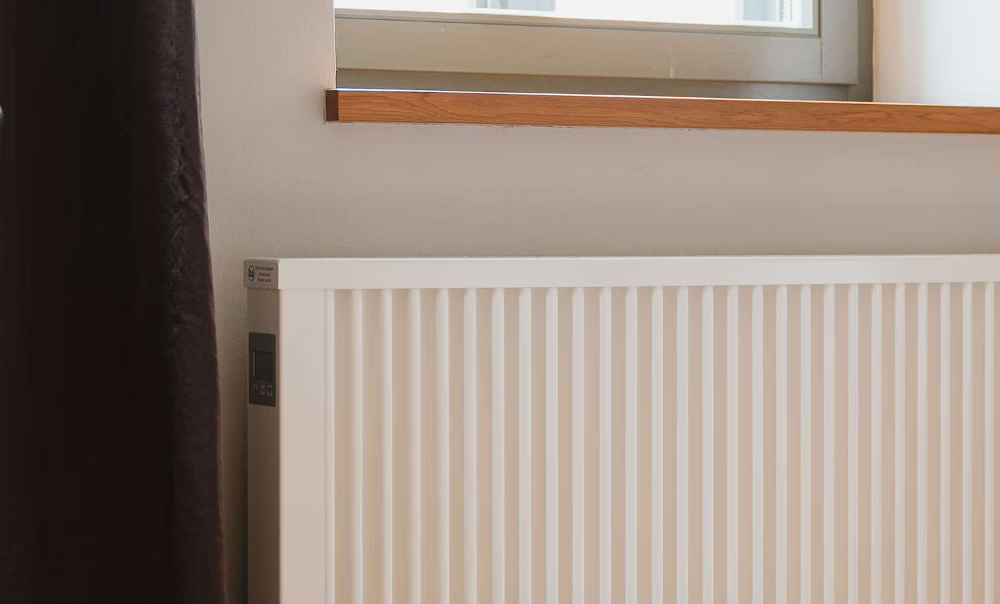
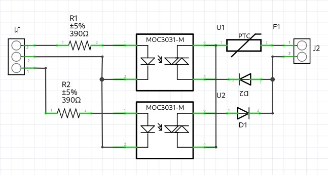

# Fil-pilote 

This application is able to control DIY electrical circuit to send order to fil-pilote heaters.

The "fil-pilote" protocol is only available in France.

## Features

-   Creates multiple areas to send different orders to different zones (ground floor, first floor, cave...)
-   Dashboard widget to send order to specific area

## Circuit

At the time of writing this note, I don't believe a ready-to-use circuit exists on the internet. So You have to use your soldering iron.

All the parts cost less than 10€, and it takes half an hour to solder everything ;-)

Here the list of components for a single fil-pilote line:

-   2 inputs terminal block x1
-   3 inputs terminal block x1
-   1N4004 diods x2
-   200mA 250V fuse x1
-   390ohms resistor x2
-   MOC3041 x2

> Be careful, you will manipulate 220v on J2 side !

## Raspberry pi connections

-   Terminal J1 #1 is connected to raspberry on GPIO pin (configured as gpio1 on app)
-   Terminal J1 #2 is connected to raspberry on Ground pin
-   Terminal J1 #3 is connected to raspberry on GPIO pin (configured as gpio2 on app)
-   Terminal J2 #1 is connected to 220 phase
-   Terminal J2 #2 is connected to heater fil-pilote

Terminal J1 #1 and #2 are configured through filpilote application.

> Keep in mind order is important otherwise pre-configured some mode will be reversed.

### Connection example

Using consecutive pins 39-37-35 from top left raspberry pi gpios, they will be connected like this:
-   Pin39 (GND) is connected to Terminal J1 #2
-   Pin37 (GPIO26) is connected to Terminal J1 #3 and configured as gpio1 on filpilote app
-   Pin35 (GPIO19) is connected to Terminal J1 #1 and configured as gpio2 on filpilote app

## Links

-   The circuit is strongely inspired from [HeaPi](https://www.aplu.fr/v2/post/2020/11/07/HeaPi-ou-piloter-des-convecteurs-%C3%A9lectrique-avec-un-Raspberry-Pi) project and [rPilote](http://hacks.slashdirt.org/hw/rpilote/)
